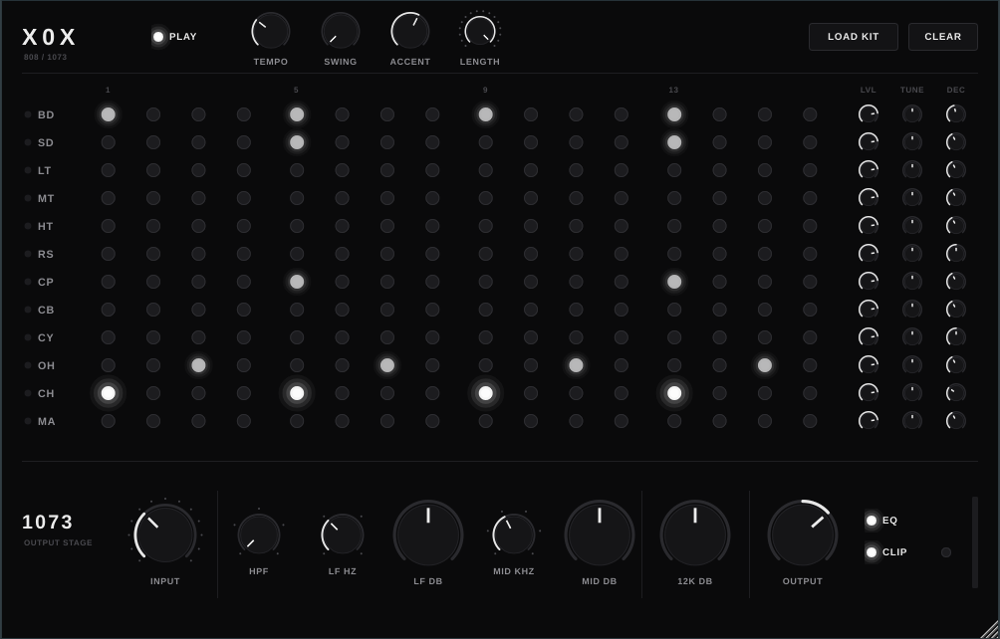

# X0X

An 808 that fucks.

Twelve analog-modelled 808 voices (or your own samples), a 16-step sequencer of white lights,
and a 1073-style channel on the output so you can drive it, clip it and EQ it like a Neve.



## What's in the box

**Drums.** BD, SD, LT, MT, HT, RS, CP, CB, CY, OH, CH, MA. Each track has a built-in
synthesized 808 voice (bridged-T style kick with pitch sweep, dual-tone snare, six-square-wave
metal hats and cymbal, four-burst clap, 540/800 Hz cowbell...) plus a sample slot for your own
packs. Level, Tune and Decay per track. Closed hat chokes open hat.

**Sequencer.** 16 steps x 12 tracks. Click a light to cycle off > on > accent, drag to paint,
right-click to erase, shift-click for accent. Swing (50-75 %), pattern length (1-16), accent
amount. Follows the host transport and tempo in a DAW; has its own clock and tempo standalone.
Space bar toggles play. MIDI notes trigger the drums (GM-ish: 36 BD, 38 SD, 41 LT, 45 MT, 50 HT,
37 RS, 39 CP, 56 CB, 49 CY, 46 OH, 42 CH, 70 MA, or C4 upwards in track order).

**1073 output stage.** The whole kit runs through one channel, 4x oversampled:

```
INPUT (stepped, -20..+40 dB) -> class-A input stage (asymmetric saturation)
  -> HPF 50/80/160/300 Hz, 18 dB/oct
  -> LF shelf 35/60/110/220 Hz, +/-16 dB
  -> MID bell 0.36/0.7/1.6/3.2/4.8/7.2 kHz, +/-18 dB, proportional Q
  -> HF shelf 12 kHz, +/-16 dB
  -> class-A output stage -> output transformer (core saturates harder on lows)
  -> OUTPUT trim -> CLIP (soft-knee ceiling at 0 dBFS)
```

Crank INPUT and pull OUTPUT down: that is where the thickness lives. EQ in/out switch, CLIP
switch with a light that shows when the ceiling is working.

**Samples.** Drag a WAV/AIFF/FLAC/OGG/MP3 onto a row, or right-click a track name. "Load Kit"
points at a folder and maps files by name (kick, snare, clap, "oh", "ch", tom1...). Tune
repitches, Decay shortens the sample (fully clockwise plays it whole). Sample paths are saved with
the preset / project.

## Building

Needs CMake 3.22+, a C++17 compiler and git. JUCE 9 is fetched automatically on first configure.

```sh
cmake -S . -B build -DCMAKE_BUILD_TYPE=Release
cmake --build build --config Release -j
```

Outputs land in `build/X0X_artefacts/Release/`:

| Format     | Path                                   | Platform      |
|------------|----------------------------------------|---------------|
| VST3       | `VST3/X0X.vst3`                        | all           |
| AU         | `AU/X0X.component`                     | macOS         |
| Standalone | `Standalone/X0X` (`.app` / `.exe`)     | all           |

Copy the VST3 / AU into your plugin folder (or configure with `-DJUCE_COPY_PLUGIN_AFTER_BUILD=ON`
style settings in CMakeLists if you prefer). On Linux you need the usual JUCE dev packages
(`libasound2-dev libfreetype6-dev libfontconfig1-dev libx11-dev libxrandr-dev libxinerama-dev
libxcursor-dev libxext-dev libxi-dev libgl1-mesa-dev libcurl4-openssl-dev`).

GitHub Actions builds macOS, Windows and Linux on every push and attaches the binaries as
workflow artifacts.

## Checks

`x0x_render` renders the default pattern clean and driven, fires every voice, measures the EQ
bands and the saturation, and writes demo WAVs:

```sh
./build/x0x_render_artefacts/Release/x0x_render /tmp/x0x-render
```

## Layout

```
Source/
  PluginProcessor.*   parameters, sequencer clock, MIDI, sample loading, state
  PluginEditor.*      the black-and-white UI
  DrumSynth.*         the twelve 808 voices + sample player
  Neve1073.*          the output stage
  DspUtils.h          filters, envelopes, oscillators
  LookAndFeel.h       knobs, lights, colours
tests/RenderTest.cpp  offline render + DSP checks
```
